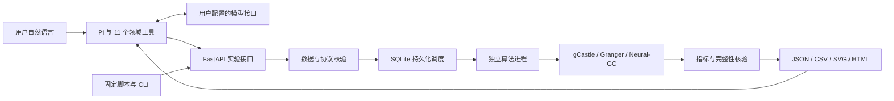

# EC Eval Agent · 脑连接自动评测智能体

[](LICENSE)

**用自然语言组织脑连接算法实验，让数据、参数、执行和结果留在同一条可追溯流程中。**

EC Eval Agent 使用 [Pi](https://github.com/earendil-works/pi) 作为智能体框架，以 [gCastle](https://github.com/huawei-noah/trustworthyAI/tree/master/gcastle) 为合成数据与因果发现算法库，接入条件 Granger 和 Neural-GC cMLP。用户描述实验需求后，Agent 查询算法能力、准备数据、验证协议、提交任务、查询状态，并根据真实结果导出报告。

项目提供单机 Python 后端、Pi 扩展、固定脚本入口和 Docker 构建方案。它面向脑区时间序列上的连接估计与算法评测，也可用于带真值的合成数据实验。项目不包含完整 MRI 预处理，输入应为已准备好的数值矩阵。

> **交付内容：** 5 种连接估计算法、11 个 Pi 领域工具、持久化任务调度和完整证据导出。系统评测、技术选型与代码规模见文末链接。

## 这是什么

比较脑连接方法时，工作往往分散在数据生成脚本、算法仓库、参数文件和绘图代码中。相同名称的指标可能采用不同方向或自连接口径，任务失败后也容易丢失上下文。本项目将这些步骤放到一套明确的实验协议中，统一输入检查、参数默认值、矩阵方向、进程状态和结果证据。

Agent 负责理解需求和调用工具，Python 后端负责校验、计算和保存结果。用户也可以绕过模型，用命令行提交同一协议。系统评测可据此逐项检查 Agent 实际提交的协议和产生的结果。关闭 Pi 不会停止已经提交给后端的实验。

本项目的集成工作包括协议建模、算法适配、任务调度、失败处理、评价口径、文件校验、报告导出和领域工具设计。Pi、gCastle 及 Neural-GC 提供的算法与框架保留其来源和许可证，不作为本项目原创算法。

## 功能与算法

- 自然语言任务与固定脚本共用同一套 HTTP API。
- 生成线性或非线性 SEM、动态 VAR/tanh 合成数据，导入 NPY 或无表头数值 CSV。
- 固定数据编号、方法参数、随机种子、设备和超时预算，再提交实验。
- 独立进程执行算法，记录排队、运行、成功、失败、取消与重试状态。
- 输出逐次运行指标、汇总 JSON、CSV、连接矩阵 SVG 与 HTML 报告。
- 保存协议哈希及运行文件校验和，收集结果时检查完整性。

| 方法 | 实现来源 | 输入与假设 | 当前适配设备 |
|---|---|---|---|
| NOTEARS | gCastle 1.0.3 | 静态观测、线性无环 SEM | CPU |
| GOLEM | gCastle 1.0.3 | 静态观测、线性无环 SEM | CPU / CUDA |
| DAG-GNN | gCastle 1.0.3 | 静态观测、无环图模型 | CPU / CUDA |
| 条件 Granger | 项目 NumPy/SciPy 适配器 | 有时间顺序的线性滞后预测 | CPU |
| Neural-GC cMLP | 固定提交的 Neural-GC 源码 | 非线性时序预测与组稀疏结构 | CPU / CUDA |

静态方法可以用于脑区时间序列上的探索，系统会记录其样本依赖、无环与观测假设，不会仅因为研究对象是脑数据就拒绝运行。估计方向不自动等于生理因果关系。IID 合成样本也不能被伪装成时间序列来运行时序方法。

## 架构



后端采用单机 SQLite WAL 与文件存储，串行调度算法运行，不要求 Redis 或消息队列。模型接口、交互界面与实验进程分开：任务编号连接协议、运行状态与结果文件。更详细的模块和接口见 [架构说明](docs/architecture.md)。

## 怎么装：Docker

### 1. 准备环境

推荐使用 Linux x86_64，安装 Docker Engine，并确认当前用户能执行 `docker info`。默认 CPU 模式不要求 NVIDIA Container Toolkit。镜像仍包含 CUDA 12.8 版 PyTorch，GPU 模式另需兼容驱动与 NVIDIA 容器运行时。

构建需要访问基础镜像、Python 与 npm 软件源。已导出的镜像可以离线导入，固定脚本实验也可离线执行。自然语言 Agent 需要访问用户配置的模型服务。请预留足够磁盘空间：当前镜像归档约 3.95 GiB，解包与构建缓存还会占用额外空间。

### 2. 从公开源码构建

```bash
git clone https://github.com/shertheus/ec-eval-agent.git
cd ec-eval-agent
bash scripts/build-image.sh
cd dist
```

`dist/` 中会生成镜像归档、SHA-256 校验文件、安装脚本、启动器、配置模板和安装说明。当前 Git 仓库提供完整构建源码，**不包含约 4 GB 的镜像归档，也没有预设的公开镜像下载地址**。若已从维护者获得离线交付包，可直接进入该交付目录，从下一步开始。

### 3. 配置模型

```bash
cp config/deepseek.env.example config/deepseek.env
chmod 600 config/deepseek.env
```

用编辑器填写该文件。默认模板如下，密钥由用户自己的账户提供：

```dotenv
DEEPSEEK_API_KEY=your_api_key
DEEPSEEK_BASE_URL=https://api.deepseek.com
DEEPSEEK_MODEL=deepseek-flash
```

也可使用经过验证的 OpenAI Chat Completions 兼容网关。`DEEPSEEK_MODEL` 必须是该服务实际提供且账户有权限访问的模型名，不能把内部网关别名直接套用于其他服务。2026-11-15 的开发者验收使用网关模型别名 `deepseek-latest-flash`。配置改动后重新进入 Pi 即可。

密钥文件由 Node 的 `--env-file` 读取，不作为 shell 脚本执行，不写入镜像，也不提交到 Git。若只想先运行不依赖模型的算法样例，可以暂不填写密钥。

### 4. 导入、安装与运行

```bash
sha256sum -c brain-eval-image.tar.gz.sha256
docker load -i brain-eval-image.tar.gz
bash install.sh
./brain-eval doctor
./brain-eval demo --methods notears
./brain-eval
```

安装脚本也会在镜像尚未导入时自动加载归档。默认创建名为 `brain-eval` 的容器，以当前用户 UID/GID 运行，采用 CPU 模式。服务不发布到公网端口，CLI 通过 `docker exec` 访问容器内后端。

已有同名容器时脚本会停止并说明原因，不覆盖旧结果。配置、输入、工作目录和 Pi 状态挂载到安装目录中，删除容器与删除这些目录是不同操作。不同安装实例应使用不同目录和容器名。

### 5. 使用宿主机代理或 GPU

如果模型必须通过 Linux 宿主机回环端口上的 HTTP 代理访问，在 `config/deepseek.env` 中添加：

```dotenv
HTTP_PROXY=http://127.0.0.1:18083
HTTPS_PROXY=http://127.0.0.1:18083
NO_PROXY=127.0.0.1,localhost,::1
```

并将安装命令改为：

```bash
bash install-local-proxy.sh
```

该入口使用 Linux host 网络，后端只绑定 `127.0.0.1:18765`。请先确保代理已存在，脚本不会自动创建代理。代理在另一台计算机时，可自行建立仅绑定回环地址的 SSH 转发。标准桥接网络容器中的 `127.0.0.1` 指向容器自身，不能直接代替宿主机地址。

GPU 环境由管理员配置完成后，在新的安装目录指定可用 GPU：

```bash
BRAIN_EVAL_GPU=0 bash install.sh
./brain-eval demo --device cuda --methods golem dag_gnn
```

GPU 容器需在配置 NVIDIA Container Toolkit 后验收。更多参数及录屏操作见 [Docker 快速安装](docs/docker-quickstart.md)。

## 怎么跑

进入 `./brain-eval` 后，可以输入：

> 生成5节点、200样本的线性SEM合成数据，边数参数4，数据种子42。使用NOTEARS在CPU运行，算法种子42，max_iter=20、lambda1=0.1、w_threshold=0.3。先验证协议再提交，等待结束并导出报告。报告F1、SHD、运行耗时和实际真值边数。完成后导出证据 ZIP。

Agent 应先查询能力，再准备数据和检查协议，最后提交并等待结果。输出应包含实验编号与证据路径。gCastle ER 生成器的边数参数不保证实际生成精确数量的边，数据元信息单独记录 `realized_offdiagonal_edges`。

无需模型的固定脚本示例：

```bash
./brain-eval demo --methods notears golem dag_gnn
./brain-eval demo --kind var --methods granger neural_gc
./brain-eval list
```

以上是 CPU 短预算安装样例。参数在提交前确定，失败运行保留日志并计入结果汇总。正式算法比较可在同一套协议中增加样本规模、训练预算与重复种子。

## 导入脑区时间序列

将预处理后的文件放入安装目录的 `input/`。支持纯数值 NPY 与无表头 CSV，行表示时间点或观测，列表示脑区。`examples/import.json` 展示数据来源与时间语义字段。Docker 中内置示例路径为 `/app/examples/import.json`，该示例期待 `input/roi_timeseries.npy`：

```bash
./brain-eval dataset /app/examples/import.json
```

自定义文件名和元信息时，可直接让 Pi 使用 `prepare_dataset` 工具导入 `input/` 下的文件，并明确数据来源、脑区顺序和采样间隔。不要向公开仓库提交受试者数据。导入器会检查路径范围、非有限值、常量通道和矩阵形状，不会擅自插值、删通道或改变预处理。

真实脑区数据通常没有连接结构真值，此时系统不计算恢复 F1 或 SHD。模型种子之间的图稳定性只描述优化重复性，不等同于生物学可靠性、重测信度或跨受试者泛化。

## 结果、指标与任务管理

安装目录中的结果结构如下：

```text
workspace/
├── datasets/<dataset_id>/       # 数据、元信息与可选合成真值
├── experiments/<experiment_id>/
│   ├── protocol.json            # 冻结的实验协议
│   ├── runs/<run_id>/attempt-1/ # 配置、图、指标、环境、日志、校验清单
│   └── reports/                 # summary.json、runs.csv、SVG、HTML
└── state.sqlite                 # 任务状态与事件
```

容器返回的 `/work/experiments/...` 对应安装目录下的 `workspace/experiments/...`。打开 `reports/report.html` 即可查看结果，复制报告时保留同目录的 SVG。

| 指标 | 口径 | 条件 |
|---|---|---|
| Precision / Recall / F1 | 按有向边计算，排除对角线，零分母记为零 | 存在结构真值 |
| SHD | 增边、删边计数，孤立反向边记一次操作 | 存在结构真值 |
| runtime_seconds | 算法适配器执行的墙钟时间 | 不含完整 Agent 对话耗时 |
| edge_count | 输出图中非对角有向边数 | 所有成功运行 |
| seed_stability_jaccard | 同一数据上不同算法种子的边集合 Jaccard | 至少两个成功种子 |

连接矩阵统一为“源节点在行、目标节点在列”。指标支持含双向边的图，不为套用 DAG 指标而自动删边。收集结果时核对运行 manifest，结果文件被改动会报错。汇总在每个数据实例内部跨模型种子进行，不把同一份数据的不同初始化当作独立被试。

任务控制示例，`exp_xxx` 请替换为实际编号：

```bash
./brain-eval status exp_xxx
./brain-eval results exp_xxx
./brain-eval cancel exp_xxx
./brain-eval retry exp_xxx
./brain-eval logs
./brain-eval stop
./brain-eval start
```

重试保留协议和历史尝试，修改参数需要新建实验。退出 Pi 不停止后端任务，但停止容器会中断运行。系统记录中断状态，支持按原协议显式重跑。

## 数据检查、实验对比与证据导出

新增的三个工具同时支持 Pi 和命令行，覆盖运行前检查与运行后交付：

```bash
./brain-eval inspect-data ds_xxx
./brain-eval compare exp_first exp_second
./brain-eval export exp_xxx
```

`inspect-data` 核验观测文件，返回节点均值、标准差、极值以及时间序列的一阶自相关。通过这些统计可以确认列顺序、尺度与时间依赖，再决定后续实验配置。

`compare` 对照两个或多个已结束的实验，默认要求数据内容与语义匹配，并列出各自参数、设备、种子、指标和失败运行。不同导入编号只要数据内容相同，也可以匹配；显式允许不同数据时，结果按数据签名区分。

`export` 生成带逐文件 SHA-256 清单的 ZIP，包含协议、运行结果、报告与日志。原始观测和模型配置保留在安装目录中，便于将证据包单独交给其他使用者检查。导出路径位于 `workspace/exports/`。详细操作见 [新增功能说明](docs/extra-features.md)。

## 源码开发与测试

需要 Python 3.11 和 Node.js 22.19 或以上版本。以下命令在仓库根目录执行，不要求沿用开发者的 Conda 路径：

```bash
python3.11 -m venv .venv
.venv/bin/python -m pip install torch==2.7.1 --index-url https://download.pytorch.org/whl/cu128
.venv/bin/python -m pip install -r backend/requirements.lock.txt
(cd agent && npm ci --ignore-scripts)
mkdir -p .runtime
ln -s "$PWD/.venv/bin/python" .runtime/python
ln -s "$(command -v node)" .runtime/node
cp config/deepseek.env.example config/deepseek.env
chmod 600 config/deepseek.env
bash scripts/dev.sh test
bash scripts/dev.sh serve
```

在另一个终端进入同一仓库后运行 `bash scripts/dev.sh demo --methods notears`。填写密钥后使用 `bash scripts/dev.sh chat`。若复用已有环境，可用 `BRAIN_EVAL_PYTHON` 与 `BRAIN_EVAL_NODE` 指定实际可执行文件，不必修改共享环境。

核心测试不需要模型密钥。`agent/test-extension.mjs` 检查 Pi 扩展与后端工具连接，需先启动后端。`scripts/integration_test.py` 会创建实际任务并测试取消与超时，应连接独立测试后端。不要在正式实验队列上运行故障注入测试。

## 效果如何

0.1.0 Docker 交付的历史验收结果：

| 检查 | 结果 |
|---|---|
| Docker 镜像构建、导出、校验及重新导入 | 通过 |
| 断网临时容器中的依赖检查和核心测试 | pip check 正常，9/9 测试通过 |
| NOTEARS、GOLEM、DAG-GNN CPU 小样例 | 3/3 成功 |
| 容器内真实模型任务 | 7 次工具调用成功，完成生成数据到报告导出 |
| 独立数值核验 | 小样例预测图等于真值，F1=1、SHD=0，文件校验通过 |
| GPU 容器与外部使用者验证 | 尚未完成 |

[0.2.0 Docker 验收](docs/docker-release-020.md) 已通过断网容器内 13 项测试，并通过真实模型完成数据检查、两实验对比和证据导出。Pi SDK 加载 11 个领域工具。

历史验收条件与实验编号见 [验证记录](docs/validation.md) 和 [Docker 验收记录](docs/docker-release-20261115.md)。样例报告见 [HTML 示例](examples/reports/docker-smoke/report.html)，它是历史合成数据输出，不是每次启动自动产生的新结果。

当前版本的 [系统评测报告](docs/system-evaluation.md) 比较固定脚本与真实 Pi Agent，包含预先固定的任务、四项系统指标、逐任务结果、异常输入与超时处理。任务定义、执行顺序和源码校验和随报告公开，可用 `benchmarks/run_system.py` 重跑。

[技术选型比较](docs/technical-selection.md) 对照固定脚本、Pi 和 LangGraph，说明交互、持久化、算法集成和安装方案；[代码与功能清单](docs/code-inventory.md) 提供可复现的有效代码统计。

## 已知问题

当前采用单机串行调度，适合逐项实验与课程演示。多节点并行需要扩展资源分配机制；MRI 预处理在输入本系统之前完成。算法比较应保持数据、设备与预算一致。

模型负责解释已保存的实验结果，统计检验与脑科学判断由研究设计决定。后端面向本机单用户使用，公开网络服务需要增加身份认证和隔离。GPU 容器安装与外部使用者验证是单独的验收项。

## 开源、贡献与引用

本项目集成代码使用 [MIT License](LICENSE)。gCastle 使用 Apache-2.0，Pi 和随附的 Neural-GC 代码使用 MIT。第三方代码保留原有许可证、固定提交和来源记录，详见 [THIRD_PARTY_NOTICES.md](THIRD_PARTY_NOTICES.md)。

欢迎通过 [Issues](https://github.com/shertheus/ec-eval-agent/issues) 提交可复现问题或改进建议。提交前运行相关测试，说明环境、数据形状、协议和错误日志，并移除密钥与私人数据。修改算法适配或指标时，应同时说明矩阵方向、预处理、阈值规则与兼容性影响。

使用本项目时，请注明仓库地址和具体 Git 提交。使用第三方算法开展研究时，还应引用相应论文和原始实现。课程材料可链接公开仓库、架构图、测试记录和演示视频，外部使用者验证与作者自行录屏分别记录。
