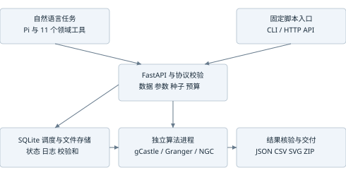
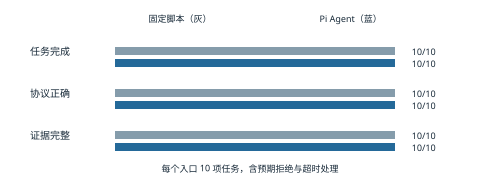
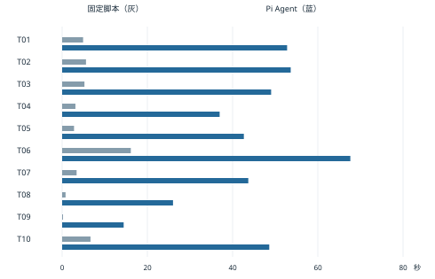

# 面向脑效应连接研究的可追溯算法评测系统

学号：待填写

姓名：待填写

学院：待填写

专业：待填写

类型：实践

正文字数：3590（按 README 中文字符统计）

开源档位：系统级目标，外部使用者验证待补

仓库链接：https://github.com/shertheus/ec-eval-agent

软件版本：0.2.0

提交日期：待填写

> 技术主体由 AI 协助整理，实测数据可回查仓库。个人反思、结论、自评与签署声明由作者补充。正式提交时使用课程封面和自检页。

## 问题与定位

脑效应连接研究需要比较不同模型如何从观测数据中估计脑区之间的有向关系。方法比较涉及数据准备、时间语义、参数、随机种子、计算设备、评价指标和结果保存。只保留一张连接图，无法说明它来自哪份数据、采用什么预算，也难以复查一次失败或重新运行同一实验。

EC Eval Agent 面向这一研究环节，将实验组织为可执行、可追溯的协议。用户可以描述“在同一份时间序列上比较两个参数设置”，由 Agent 查询能力、准备数据、检查参数并调用后端；已经确定的实验也可以通过固定脚本直接运行。两种入口共享数据检查、算法适配、任务调度和指标实现。

系统的交付对象包括算法结果和形成结果的证据。每次实验保存数据编号、内容校验和、方法参数、种子、设备、超时预算、运行状态与日志，并生成 JSON、CSV、SVG、HTML 和证据 ZIP。这样，后续研究可以定位具体实验、比较配置变化、核对异常原因，再决定是否扩大数据和训练预算。

项目聚焦预处理后数值矩阵的连接估计。输入矩阵的列对应脑区或节点，行对应观测或时间点。研究中的脑区划分、去噪和观测机制需由具体数据处理流程确定，系统通过元信息保留这些输入的来源与语义。

## 现状与证据

效应连接的解释依赖模型。Friston 对功能连接与效应连接的区分说明，统计依赖和系统间的影响需要在分析中分别处理 [1]。因此，本系统把“得到有向图”“恢复合成真值”和“解释脑区作用”分成不同层次：前两项可通过软件执行和数值检查验证，后一项需要结合研究设计与模型假设。

在算法层，NOTEARS 将无环图学习转化为连续优化问题 [2]；GOLEM 研究似然目标、稀疏性与 DAG 约束 [3]；DAG-GNN 用图神经网络构造生成模型 [4]；Neural Granger Causality 将结构化神经网络与稀疏惩罚用于非线性时序关系估计 [5]。gCastle 将数据生成、因果发现与图评价整合为 Python 工具箱，为接入多种方法提供了共同基础 [6]。

在 Agent 层，Toolformer 研究 API 选择和参数构造 [7]，AutoGen 提供可配置的对话编排 [8]，CodeAct 使用可执行代码组织动作 [15]。这些设计分别强调工具接口、交互组织和动作表达。本项目采用 Pi 终端入口和预定义领域工具，将模型组织任务的能力接到严格的实验协议上。

系统评价还需要观察实际执行。AgentBench、SWE-bench、tau-bench 和 OSWorld 分别提供交互任务、真实软件任务、目标状态检查与执行判定的研究背景 [9–12]。本项目据此明确自己的评测对象：检查实验任务是否完成、协议是否正确、证据是否完整，以及完成任务所需时间。每一项结论都能回指到后端状态或文件。

## 主体论证

### 系统架构与模块职责

系统架构如图 1。Pi 调用 11 个领域工具，FastAPI 接收请求，Pydantic 检查字段与参数，SQLite WAL 保存任务状态，算法在独立 Python 进程中运行。报告模块读取实际结果并检查文件校验和。



图 1　系统架构与证据交付路径

协议在提交前明确数据、方法、种子、设备和超时预算。提交接口使用幂等键避免重复创建同一任务；调度器管理排队、运行、成功、失败、取消和重试。重试保留原协议与历史尝试，修改参数则创建新实验。Pi 会话结束后，后端继续处理已经提交的任务。

算法适配层统一连接矩阵方向为“源节点在行、目标节点在列”。有结构真值时按有向边计算 Precision、Recall、F1 和 SHD，并排除自连接；无真值时输出边数、运行时间及可用的跨种子稳定性。汇总以同一份数据上的模型种子为重复单位。

表 1　算法接口及输入语义

| 方法 | 实现来源 | 输入与模型假设 | 适配设备 |
|---|---|---|---|
| NOTEARS | gCastle | 静态观测、线性无环 SEM | CPU |
| GOLEM | gCastle | 静态观测、线性无环 SEM | CPU / CUDA |
| DAG-GNN | gCastle | 静态观测、无环图模型 | CPU / CUDA |
| 条件 Granger | 项目 NumPy/SciPy 适配器 | 有时间顺序的线性滞后预测 | CPU |
| Neural-GC cMLP | 固定源提交 | 非线性时序预测与组稀疏结构 | CPU / CUDA |

表 1 中的静态方法可以用于脑区时间序列上的探索，此时系统记录其观测样本和无环假设。Granger 和 Neural-GC 使用时间顺序，验证器会拒绝把 IID 样本直接作为时序输入的协议。

### 技术选型比较

本项目需要直接的终端交互、统一算法接口和持久实验记录。表 2 比较固定脚本、Pi 和 LangGraph。Pi 已提供终端对话、JSON 模式、模型配置与扩展接口，因此当前实现采用 Pi；长期运行的算法任务交给独立后端。

表 2　Agent 与固定流程方案比较

| 维度 | 固定脚本 | Pi 加领域工具 | LangGraph |
|---|---|---|---|
| 入口 | JSON 或命令行参数 | 终端自然语言 | 应用自建入口与状态图 |
| 步骤组织 | 程序显式编排 | 模型选择工具，后端校验协议 | 节点、边和状态显式建模 |
| 持久化 | 项目后端 | Pi 会话与实验后端分开保存 | 提供工作流持久化与中断机制 |
| 适用工作 | 参数明确的批量任务 | 临时组合任务和交互查询 | 多分支、人工审批和复杂状态恢复 |
| 当前使用情况 | 已实现，作为无 AI 基线实测 | 已实现并接入真实模型 | 官方文档能力比较 |

固定脚本保留为正式入口。Agentless 对简单流程的研究也提示，复杂自治流程需要与明确的基线比较 [13]。该论文的方法仍使用 LLM，本项目的固定脚本基线则直接调用 HTTP API，不调用语言模型。

算法库采用 gCastle 接入 SEM、NOTEARS、GOLEM 和 DAG-GNN，另适配 Granger 与固定版本的 Neural-GC。项目的原创工作集中于协议、调度、指标、文件校验和领域工具。技术来源与许可证保留在第三方说明中。

部署选择 Docker，将 Python、CUDA 版 PyTorch、Node 和 Pi 放入一个镜像，配置、输入、结果和 Pi 状态分别挂载。开发阶段复用已有 Conda；安装阶段无需迁移整个开发环境。GPU 模式依赖宿主机驱动和 NVIDIA Container Toolkit，当前 Docker 验收使用 CPU。更完整的比较及官方来源见 [技术选型文档](../docs/technical-selection.md)。

### 系统评测方法

评测预先固定 10 个任务，每个任务分别由确定性脚本和真实 Pi Agent 执行一次，共 20 次。任务覆盖五种算法、多方法与种子组合、无真值导入、输入不兼容、NaN 和计算超时。每次使用独立后端、工作目录和 Pi 状态，入口顺序使用固定随机种子打乱。

两个入口使用相同数据配置、方法参数、种子、设备和预算。9 组有效数据的观测 SHA-256 完全一致；NaN 输入应在创建数据集之前被拒绝。算法统一在 CPU 上运行，线程数为 2；环境为 Python 3.11.10、PyTorch 2.7.1+cu128、gCastle 1.0.3。Agent 使用 Pi 1.5.0 和服务模型标识 deepseek-latest-flash。

任务完成要求实际状态、协议和证据满足任务定义。协议正确核对数据配置、标准化参数、种子、设备、预算和尝试次数。证据完整检查实际工具调用、报告、ZIP 与成功运行的 manifest。端到端时间从后端就绪开始，包含 Pi 启动、模型推理、工具往返和交付，不包含脚本编写时间。

### 系统评测结果

表 3 和图 2 给出系统指标。两个入口在这组任务上均完成 10/10，协议和证据检查均通过。T08–T10 的完成表示按预期拒绝输入或处理超时，其中 T10 的算法状态仍为失败并保留在记录中。

表 3　系统指标结果

| 指标 | 固定脚本 | Pi Agent |
|---|---:|---:|
| 任务完成数 | 10/10 | 10/10 |
| 协议正确数 | 10/10 | 10/10 |
| 证据完整数 | 10/10 | 10/10 |
| 平均端到端耗时 | 4.88 秒 | 43.54 秒 |
| 中位端到端耗时 | 4.15 秒 | 46.14 秒 |
| 最长端到端耗时 | 16.11 秒 | 67.63 秒 |



图 2　两种入口的任务与证据检查结果

图 3 展示逐任务耗时。固定脚本适合参数已经明确的重复执行；Pi 将同一套能力提供为自然语言交互，并产生相应的推理与工具往返开销。任务、数据和耗时的对应关系见表 4。



图 3　十项配对任务的端到端耗时

表 4　逐任务场景与耗时

| 任务 | 场景 | 固定脚本秒数 | Pi 秒数 |
|---|---|---:|---:|
| T01 | SEM 与 NOTEARS | 4.92 | 52.79 |
| T02 | SEM 与 GOLEM | 5.60 | 53.64 |
| T03 | SEM 与 DAG-GNN | 5.23 | 49.04 |
| T04 | VAR 与 Granger | 3.11 | 36.96 |
| T05 | VAR 与 Neural-GC | 2.79 | 42.64 |
| T06 | 两种方法、两个种子 | 16.11 | 67.63 |
| T07 | 无真值 CSV 导入 | 3.39 | 43.68 |
| T08 | IID 输入调用 Granger | 0.80 | 26.02 |
| T09 | CSV 含 NaN | 0.20 | 14.44 |
| T10 | GOLEM 超过 5 秒预算 | 6.65 | 48.60 |

每个任务每个入口执行一次，所有首次结果均计入统计。这组系统测试使用安装级训练预算；正式算法比较可另设数据规模、训练预算和重复次数。任务定义、执行顺序、源码哈希及完整分项结果见 [系统评测报告](../docs/system-evaluation.md)。

### 失败案例与纠正过程

T08 的输入为没有时间顺序的 IID SEM 样本，验证器按 Granger 的滞后语义拒绝协议，未创建实验。T09 的 CSV 含 NaN，导入器返回错误并保留原文件。T10 的 GOLEM 设置为一百万次迭代，超过五秒预算后由调度器终止，保存 failed/timeout 状态和失败报告。

在新增功能的 Docker 验收中，Pi 将 seed 放入 Granger 的方法参数，两份初始协议都被验证器以“unsupported granger parameters: ['seed']”拒绝。Pi 根据反馈将种子移到协议级 seeds，验证通过后提交。两个实验均成功，随后完成同数据比较和 ZIP 导出。该过程展示了协议校验如何在训练开始前纠正模型生成的配置；它单独记录，不并入上述十任务统计。

### 新增能力与安装交付

新增数据检查返回节点均值、标准差、极值和时间序列一阶自相关，帮助用户确认形状、尺度与时间依赖。跨实验对比默认匹配数据内容和语义，列出参数、设备、种子和失败运行。证据 ZIP 收集协议、结果、环境、日志与报告，并附逐文件 SHA-256 清单。

这些能力服务于科研流程中的实验执行与证据管理。The AI Scientist 将想法形成、代码、实验、图表和报告纳入更广的自动化流程 [14]，本项目则以明确协议和可复查产物完成其中的实验环节。

Docker 0.2.0 已通过镜像校验、重新导入与独立容器启动。断网容器内 13 项测试全部通过，真实 Pi 完成两个 Granger 实验及两份 ZIP 导出；每份归档的 15 个证据文件均通过哈希核验。按 AST 和 tokenize 统计，原创后端为 1031 行有效代码、67 个函数、15 个非空模块文件，排除第三方、注释、文档字符串、测试和脚本。

安装包的标准操作为：

```bash
sha256sum -c brain-eval-image.tar.gz.sha256
docker load -i brain-eval-image.tar.gz
bash install.sh
./brain-eval doctor
./brain-eval
```

模型通过宿主机回环代理访问时，安装入口改为 `bash install-local-proxy.sh`。模型密钥在镜像外配置。录屏文件输入、提示词和时间安排见 [操作稿](recording-script.md)，材料完成状态见 [提交核对表](submission-checklist.md)。

## 反思与迁移

待作者独立撰写。可结合 seed 参数纠正、脚本与 Pi 的执行开销、无真值指标选择，以及本人安装和使用体验，说明具体判断如何变化，并与实际阅读的文献对话。后续动作写明对象、时间与验收方式。

## 结论与后续

待作者结合本人研究目标、实测证据和使用体验独立填写。

## 参考文献

[1] Friston K J. Functional and Effective Connectivity: A Review. Brain Connectivity, 1(1), 2011. [原始来源](https://doi.org/10.1089/brain.2011.0008)

[2] Zheng X, Aragam B, Ravikumar P, Xing E P. DAGs with NO TEARS: Continuous Optimization for Structure Learning. NeurIPS 2018, 2018. [原始来源](https://arxiv.org/abs/1803.01422)

[3] Ng I, Ghassami A, Zhang K. On the Role of Sparsity and DAG Constraints for Learning Linear DAGs. NeurIPS 2020, 2020. [原始来源](https://arxiv.org/abs/2006.10201)

[4] Yu Y, Chen J, Gao T, Yu M. DAG-GNN: DAG Structure Learning with Graph Neural Networks. ICML 2019, 2019. [原始来源](https://arxiv.org/abs/1904.10098)

[5] Tank A, Covert I, Foti N, Shojaie A, Fox E. Neural Granger Causality. arXiv:1802.05842; accepted revision 2021, 2018. [原始来源](https://arxiv.org/abs/1802.05842)

[6] Zhang K, Zhu S, Kalander M, et al.. gCastle: A Python Toolbox for Causal Discovery. arXiv:2111.15155, 2021. [原始来源](https://arxiv.org/abs/2111.15155)

[7] Schick T, Dwivedi-Yu J, Dessì R, et al.. Toolformer: Language Models Can Teach Themselves to Use Tools. arXiv:2302.04761, 2023. [原始来源](https://arxiv.org/abs/2302.04761)

[8] Wu Q, Bansal G, Zhang J, et al.. AutoGen: Enabling Next-Gen LLM Applications via Multi-Agent Conversation. arXiv:2308.08155, 2023. [原始来源](https://arxiv.org/abs/2308.08155)

[9] Liu X, Yu H, Zhang H, et al.. AgentBench: Evaluating LLMs as Agents. arXiv:2308.03688; published ICLR 2024, 2023. [原始来源](https://arxiv.org/abs/2308.03688)

[10] Jimenez C E, Yang J, Wettig A, et al.. SWE-bench: Can Language Models Resolve Real-World GitHub Issues?. arXiv:2310.06770; published ICLR 2024, 2023. [原始来源](https://arxiv.org/abs/2310.06770)

[11] Yao S, Shinn N, Razavi P, Narasimhan K. tau-bench: A Benchmark for Tool-Agent-User Interaction in Real-World Domains. arXiv:2406.12045, 2024. [原始来源](https://arxiv.org/abs/2406.12045)

[12] Xie T, Zhang D, Chen J, et al.. OSWorld: Benchmarking Multimodal Agents for Open-Ended Tasks in Real Computer Environments. arXiv:2404.07972, 2024. [原始来源](https://arxiv.org/abs/2404.07972)

[13] Xia C S, Deng Y, Dunn S, Zhang L. Agentless: Demystifying LLM-based Software Engineering Agents. arXiv:2407.01489, 2024. [原始来源](https://arxiv.org/abs/2407.01489)

[14] Lu C, Lu C, Lange R T, Foerster J, Clune J, Ha D. The AI Scientist: Towards Fully Automated Open-Ended Scientific Discovery. arXiv:2408.06292, 2024. [原始来源](https://arxiv.org/abs/2408.06292)

[15] Wang X, Chen Y, Yuan L, et al.. Executable Code Actions Elicit Better LLM Agents. ICML 2024, 2024. [原始来源](https://arxiv.org/abs/2402.01030)

## 附录  AI  使用声明

下表记录已发生的辅助环节。采纳程度、人工核验操作、生成内容比例、签名与日期由作者确认后，与独立声明表保持一致。

| 环节 | 工具与版本 | 用途 | 提示词要点 | 采纳程度 | 人工核验方式 |
|---|---|---|---|---|---|
| 开发与调试 | Codex，具体模型待核对 | 生成和修改后端、Pi 扩展、测试与 Docker | Pi、gCastle、脑连接评测、Docker 交付 | 已纳入代码，待本人确认 | 待填写实际代码检查与复现操作 |
| 系统运行 | Pi 1.5.0，deepseek-latest-flash | 调用工具执行固定任务 | 固定数据、参数、种子与预算 | 实测记录已保存，待本人确认 | 待填写实际协议和结果检查 |
| 数据与图表 | Codex、Python 脚本 | 汇总实测 JSON 并制图 | 真实记录、可复算指标 | 技术材料，待本人确认 | 待填写复算与图表检查 |
| 技术文档 | Codex、anti-defensive-writing | 技术说明、选型比较和语言整理 | 按规范组织证据，删除空泛表述 | 初稿，待本人修改确认 | 待填写技术解释核对方式 |
| 文献检索 | Codex 网页检索 | 核对来源元数据与摘要 | 算法、工具调用与系统评测 | 候选清单，待本人确认引用 | 待填写实际原文阅读范围 |

AI 生成内容占全文比例（估计）：待本人填写。

使用 AI 生成图表：待本人确认并注明。

开源档位自评：待本人填写。

签名：待本人签署。日期：待本人填写。

诚信声明：本报告的分析、结论与对策均由本人独立完成，所有引用真实可查；如有不实，愿承担学术不端责任。
