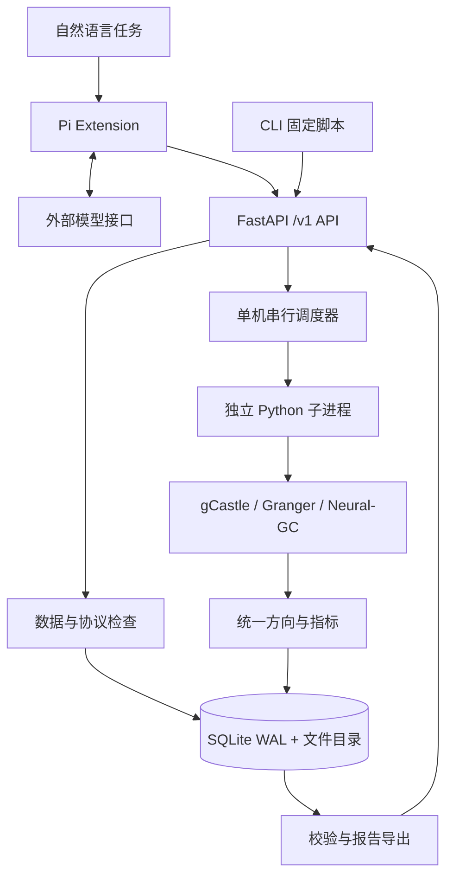

# 架构与执行约定

版本：0.1.0。更新：2026-11-15。本文描述已实现的单机系统，验收边界见 [validation.md](validation.md)。

## 总体结构

Pi 不计算指标，不直接编辑算法，也不承担持久化调度。默认只启用八个领域工具。CLI 与 Pi 使用相同后端，因此固定脚本可作为自动化评测的执行基线。完整研究基线比较尚未完成。

## 模块

| 模块 | 文件 | 责任 |
|---|---|---|
| 输入契约 | backend/brain_eval/contracts.py | 严格字段、参数类型、规模与种子范围 |
| 数据 | backend/brain_eval/datasets.py | SEM、VAR/tanh、NPY/CSV 导入、真值与校验和 |
| 协议 | backend/brain_eval/protocols.py | 方法适用性、规范参数、任务矩阵与警告 |
| 调度与存储 | experiments.py、storage.py | SQLite 状态、串行执行、取消、超时、重试、恢复 |
| 算法执行 | adapters.py、worker.py | 子进程隔离、设备选择、第三方接口与原始证据 |
| 指标与报告 | metrics.py、reports.py | 有向图指标、哈希核验、CSV/JSON/SVG/HTML |
| 服务与固定脚本 | server.py、cli.py | 版本化 HTTP API 和非模型入口 |
| 智能体 | agent/extensions/brain-eval.ts | 工具定义与科研流程约束 |
| 安装 | docker/Dockerfile、install*.sh、brain-eval | 镜像、数据挂载、启动与交互 |

原版 gCastle 1.0.3 与 NetworkX 3 的兼容处理在 compat.py 中完成，不修改共享 site-packages。Neural-GC 代码保留原始许可证、提交号和哈希，适配时统一输出矩阵方向。

## 八个工具

| 工具 | API | 行为 |
|---|---|---|
| inspect_environment | GET /v1/environment | 软件环境和可见 GPU 信息 |
| list_capabilities | GET /v1/capabilities | 方法、数据类型、参数范围与指标 |
| prepare_dataset | POST /v1/datasets | 创建数据快照与元信息 |
| validate_protocol | POST /v1/protocols/validate | 校验并展开规范化协议，不启动实验 |
| submit_experiment | POST /v1/experiments | 以幂等键提交，返回实验编号 |
| inspect_experiment | GET /v1/experiments[/{id}] | 状态与可选日志，最多短等候十秒 |
| control_experiment | POST /v1/experiments/{id}/actions | 显式取消或按原协议重试 |
| collect_results | GET /v1/experiments/{id}/results | 核验成功产物并导出报告 |

另有 /v1/health 健康检查。后端默认只绑定回环地址，不是提供多用户访问控制的公网 API。

## 数据和评价约定

观测矩阵的行为样本或时间点，列为节点。连接矩阵始终为源节点在行、目标节点在列。合成真值与观测文件分别保存，真实输入没有真值时不生成恢复准确率。

SEM 可以是线性或 MLP 机制，动态生成器支持线性或 tanh 机制。导入仅支持数值 NPY 和无表头 CSV。矩阵大小、NaN/Inf、常量列和输入路径范围由后端检查。生成器边数参数不是精确的实现边数，实际边数另存元信息。

评价排除对角线。F1 基于有向边，孤立反转的 SHD 代价为一。种子汇总在同一数据实例内进行，独立数据实例不混为同一重复单位。具体实现和边界例子见 metrics.py 与 tests/test_core.py。

## 任务生命周期

协议提交后生成运行配置与任务记录。调度器一次执行一个运行，算法在独立进程中完成。完成状态写入前，先保存图、指标、环境和 manifest。取消与超时保留原因。重试保留原配置与旧尝试，改变参数必须提交新协议。

退出 Pi 不停止实验后端。容器停止可能中断当前运行，重启后恢复任务状态并允许显式重试。这是任务恢复，不是任意算法的训练检查点恢复。

## 容器与配置

镜像包含 Python 3.11、CUDA 12.8 版 PyTorch、算法依赖、Node 和 Pi。默认 CPU 安装只依赖 Docker；GPU 安装另需宿主机 NVIDIA Container Toolkit。密钥配置只读挂载到 /config，原始输入只读挂载到 /input，结果和会话分别挂载到 /work 和 /pi-state。

标准安装使用桥接网络与容器内回环地址。宿主机回环代理使用 install-local-proxy.sh 的 host 网络入口，后端默认改为 18765 端口。两种方式均以宿主机用户 UID/GID 运行，不需要挂载 Conda。Pi 领域工具约束不是操作系统级沙箱。

## 可扩展点与未完成项

新算法需声明输入语义、参数范围、设备与方向转换，输出统一邻接矩阵并保存诊断。新增指标需定义无真值、零分母与双向边行为，并增加针对边界的验证。

当前未实现分布式调度、多租户服务、完整 MRI 预处理或全部算法的训练断点续跑。GPU 容器、外部使用者安装与多任务 Agent 对照仍需单独验证。
